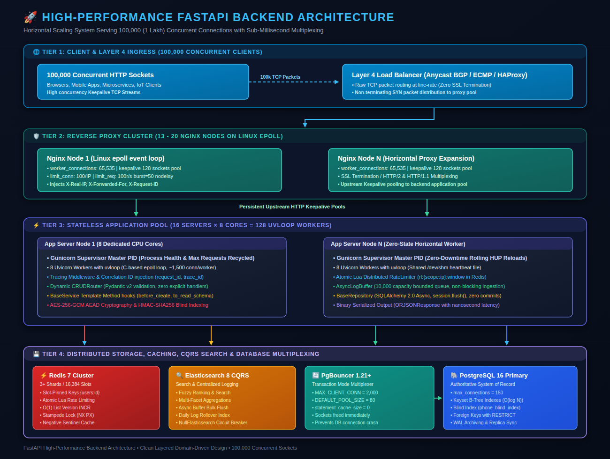
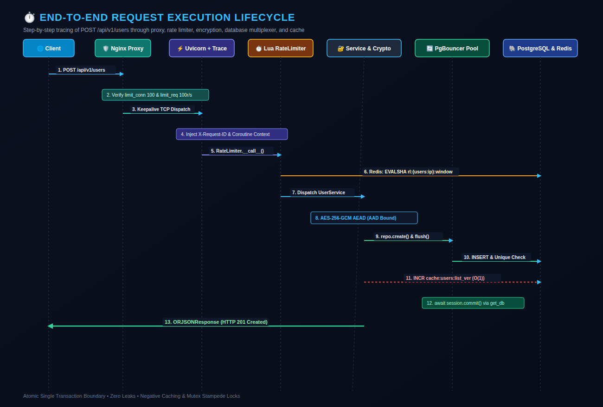
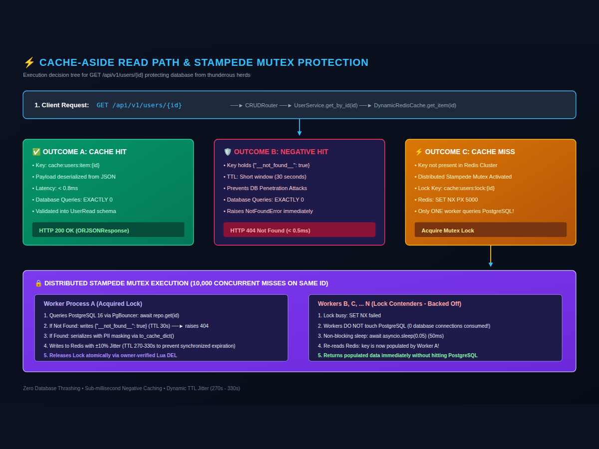
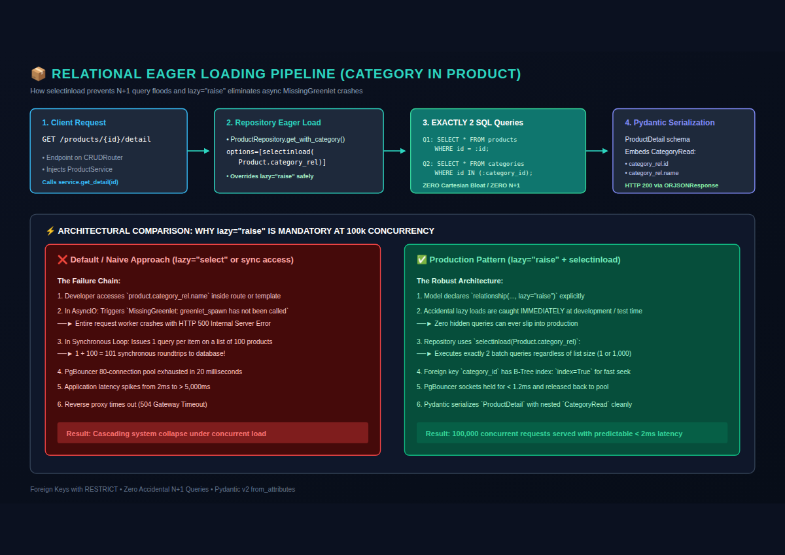

# 📖 End-to-End Execution Flow & Developer Implementation Guide

Comprehensive architectural execution trace and complete developer implementation guide for the **FastAPI High-Performance 100k Concurrency Backend Architecture**.

> 🏛️ **System Architecture & Infrastructure Specifications**: For hardware sizing math, 100,000 connection budget proofs, Docker/Kubernetes manifests, and benchmark commands, see [README.md](file:///home/nazmul/Downloads/fastapi-repo-pattern/README.md).

---

## 📑 Table of Contents

1. **[Part 1: User Request Execution Lifecycle](#part-1-user-request-execution-lifecycle)** — The complete, step-by-step path of incoming HTTP requests across all primary operational modes:
   - [1.1 Complete Write Path: `POST /api/v1/users`](#11-complete-write-path-post-apiv1users) (AES-256-GCM AEAD, blind index, cache invalidation)
   - [1.2 Complete Read Path: `GET /api/v1/users/{id}`](#12-complete-read-path-get-apiv1usersid) (Distributed mutex locking, negative caching)
   - [1.3 Keyset Cursor Pagination Path: `GET /api/v1/users`](#13-keyset-cursor-pagination-path-get-apiv1users) ($O(\log N)$ composite seek)
   - [1.4 Elasticsearch Search & Async Logging Lifecycle](#14-elasticsearch-search--async-logging-lifecycle) (CQRS full-text search and non-blocking log buffer)
   - [1.5 Relational & Nested Query Execution Lifecycle](#15-relational--nested-query-execution-lifecycle) (`selectinload` eager loading vs $N+1$ query prevention)
2. **[Part 2: Developer Implementation Workflow](#part-2-developer-implementation-workflow)** — A practical, deep guide for developers on building features:
   - [2.1 File Modification Checklist](#21-file-modification-checklist)
   - [2.2 In-Depth Step-by-Step Code Examples](#22-in-depth-step-by-step-code-examples)
   - [2.3 Unit of Work & Multi-Repository Transactions](#23-unit-of-work--multi-repository-transactions)
   - [2.4 Writing Automated Tests](#24-writing-automated-tests-teststest_orderspy)
   - [2.5 Nested Tables & Entity Relationships Guide (Category in Product)](#25-nested-tables--entity-relationships-guide-category-in-product)
     - [2.5.1 The `lazy="raise"` Rule in Async SQLAlchemy](#251-the-lazyraise-rule-in-async-sqlalchemy)
     - [2.5.2 Step 1: Model Definition with Foreign Keys & Relationships](#252-step-1-model-definition-with-foreign-keys--relationships)
     - [2.5.3 Step 2: Nested Pydantic Schemas (Embedded DTOs & Validation)](#253-step-2-nested-pydantic-schemas-embedded-dtos--validation)
     - [2.5.4 Step 3: Repository Eager Loading (`selectinload` vs `joinedload`)](#254-step-3-repository-eager-loading-selectinload-vs-joinedload)
     - [2.5.5 Step 4: Service Layer Validation & Cross-Entity Cache Invalidation](#255-step-4-service-layer-validation--cross-entity-cache-invalidation)
     - [2.5.6 Step 5: Dynamic CRUDRouter & Custom Nested Endpoints](#256-step-5-dynamic-crudrouter--custom-nested-endpoints)
     - [2.5.7 Step 6: Database Migrations with Alembic](#257-step-6-database-migrations-with-alembic)
     - [2.5.8 Step 7: Testing Relationships & Preventing N+1 Regressions](#258-step-7-testing-relationships--preventing-n1-regressions)

---

# Part 1: User Request Execution Lifecycle

This section tracks the execution flow across five primary operations:
- **Write Path**: `POST /api/v1/users` (Registration with AES-256-GCM encryption, blind indexing, and cache invalidation)
- **Read Path**: `GET /api/v1/users/{id}` (Cache-aside with stampede mutex locks and negative caching)
- **Keyset Pagination Path**: `GET /api/v1/users?limit=50&cursor=...` ($O(\log N)$ B-Tree cursor seek)
- **Elasticsearch Search & Ingestion Path**: `GET /api/v1/products/search?q=...` & Background Ingestion Buffer
- **Nested Relational Path**: `GET /api/v1/products/{id}/detail` (Eager loading `category_rel` via `selectinload`)

<p align="center">
  
</p>

---

## 1.1 Complete Write Path: `POST /api/v1/users`

<p align="center">
  
</p>

```
[Client] 
   │ HTTP POST /api/v1/users
   ▼
[Step 1: Network Ingress & Nginx] ──► deploy/nginx.conf
   │ Upstream keepalive TCP socket
   ▼
[Step 2: Process & ASGI Parsing] ───► deploy/gunicorn.conf.py & Uvicorn (uvloop)
   │ ASGI Scope Dictionary
   ▼
[Step 3: Tracing Middleware] ───────► app/main.py: request_id_and_tracing_middleware()
   │ Injects request.state.request_id
   ▼
[Step 4: Rate Limiting & Proxy IP] ─► app/services/redis_rate_limit.py: RateLimiter.__call__()
   │ Redis Lua EVALSHA verification
   ▼
[Step 5: Database Unit of Work] ────► app/core/database.py: get_db()
   │ AsyncSession instantiated (autoflush=False)
   ▼
[Step 6: Pydantic Validation] ──────► app/schemas/user.py: UserCreate.validate_e164_phone()
   │ Validated payload
   ▼
[Step 7: Endpoint Controller] ──────► app/api/v1/users.py: Dynamic CRUDRouter
   │ Delegates to service
   ▼
[Step 8: Domain Business Service] ──► app/services/user.py: UserService.create()
   │ ├─ 8a. Conflict checks: await repo.get_by(email=...)
   │ ├─ 8b. AES-256-GCM AAD encryption: app/core/security.py: CryptoService.encrypt()
   │ ├─ 8c. Blind index generation: app/core/security.py: CryptoService.blind_index()
   │ └─ 8d. Entity instantiation: User(id=user_id, ...)
   ▼
[Step 9: Generic Repository] ───────► app/repositories/base.py: BaseRepository.create()
   │ session.add(user) & await session.flush()
   ▼
[Step 10: Connection Multiplexer] ──► PgBouncer (Transaction Mode) ──► PostgreSQL 16
   │ SQL executed, UNIQUE constraints enforced; transaction remains open
   ▼
[Step 11: Cache Invalidation] ──────► app/services/base.py: DynamicRedisCache.invalidate_lists()
   │ Redis Cluster: INCR cache:users:list_ver
   ▼
[Step 12: Output Schema & Masking] ─► app/services/user.py: to_read_schema()
   │ Decrypts phone, applies mask (+1*******2671), returns UserRead
   ▼
[Step 13: Transaction Commit] ──────► app/core/database.py: get_db() exit
   │ await session.commit() ──► PgBouncer releases PostgreSQL backend connection
   ▼
[Step 14: Fast Serialization] ─────► app/main.py (ORJSONResponse)
   │ Binary JSON + X-Request-ID + X-RateLimit-* headers
   ▼
[Client receives HTTP 201 Created]
```

---

### Step-by-Step Function Execution Details (Write Path)

#### Step 1: Ingress & Reverse Proxy
- **File**: [`deploy/nginx.conf`](file:///home/nazmul/Downloads/fastapi-repo-pattern/deploy/nginx.conf)
- **Directive / Function**:
  - `limit_conn conn_limit_per_ip 100`: Rejects excess open TCP connections from the client IP.
  - `limit_req zone=req_limit_per_ip burst=50 nodelay`: Checks the leaky-bucket rate limiter.
  - `proxy_pass http://app_backend`: Selects an idle persistent keepalive socket from `upstream app_backend` (pool of 128 sockets).
  - Injects headers: `X-Real-IP`, `X-Forwarded-For`, `X-Request-ID`.

#### Step 2: ASGI Event Loop & Worker Dispatch
- **File**: [`deploy/gunicorn.conf.py`](file:///home/nazmul/Downloads/fastapi-repo-pattern/deploy/gunicorn.conf.py)
- **Component**: Gunicorn Supervisor $\rightarrow$ Uvicorn Worker (`uvloop` + `httptools`)
- **Action**:
  - The OS network socket event triggers an `epoll` notification in `uvloop`.
  - `httptools` parses the HTTP byte stream into the ASGI scope:
    ```python
    scope = {
        "type": "http",
        "method": "POST",
        "path": "/api/v1/users",
        "headers": [(b"host", b"..."), (b"x-forwarded-for", b"203.0.113.1"), ...],
    }
    ```
  - Dispatches to `FastAPI.__call__(scope, receive, send)` asynchronously without thread blocking.

#### Step 3: Tracing & Request ID Middleware
- **File**: [`app/main.py`](file:///home/nazmul/Downloads/fastapi-repo-pattern/app/main.py#L48)
- **Function**: `request_id_and_tracing_middleware(request: Request, call_next)`
- **Action**:
  - Checks `request.headers.get("X-Request-ID")`. If absent, generates `str(uuid.uuid4())`.
  - Attaches to request state: `request.state.request_id = req_id`.
  - Captures start time: `start_time = time.perf_counter()`.
  - Passes execution to the inner route handler: `response = await call_next(request)`.

#### Step 4: Rate Limiting & Proxy IP Resolution
- **File**: [`app/services/redis_rate_limit.py`](file:///home/nazmul/Downloads/fastapi-repo-pattern/app/services/redis_rate_limit.py#L82)
- **Class / Method**: `RateLimiter.__call__(self, request: Request, response: Response)`
- **Sub-functions**:
  1. `resolve_client_ip(request, settings.TRUSTED_PROXIES)`:
     - Inspects `request.client.host` (the direct TCP socket peer).
     - Validates peer against configured CIDRs (e.g. `127.0.0.1`, `10.0.0.0/8`).
     - Extracts the genuine client IP from `X-Forwarded-For`. Untrusted peers cannot spoof IP headers.
  2. Constructs Redis cluster slot-pinned key:
     `rl:{users:ip:203.0.113.1}:1698403200`
  3. Executes atomic Lua script in Redis via `EVALSHA`:
     ```lua
     local current = redis.call('INCR', KEYS[1])
     if current == 1 then
         redis.call('EXPIRE', KEYS[1], ARGV[1])
     end
     return {current, redis.call('TTL', KEYS[1])}
     ```
  4. Injects HTTP headers:
     - `X-RateLimit-Limit: 100`
     - `X-RateLimit-Remaining: 99`
     - `X-RateLimit-Reset: 1698403260`
  5. If `current > limit`, raises `HTTPException` with status 429 and `Retry-After` header.

#### Step 5: Database Unit of Work Initialization
- **File**: [`app/core/database.py`](file:///home/nazmul/Downloads/fastapi-repo-pattern/app/core/database.py#L77)
- **Function**: `get_db(request: Request) -> AsyncGenerator[AsyncSession, None]`
- **Action**:
  - Fetches the engine session factory: `session_factory = request.app.state.session_factory`.
  - Opens context manager: `async with session_factory() as session:`.
  - Produces an `AsyncSession` with:
    - `expire_on_commit = False`: Prevents lazy-load errors post-commit.
    - `autoflush = False`: Prevents unexpected intermediate SQL flushes.
  - `yield session`: Suspends here while the endpoint and service execute.

#### Step 6: Request Payload Validation & Normalization
- **File**: [`app/schemas/user.py`](file:///home/nazmul/Downloads/fastapi-repo-pattern/app/schemas/user.py#L22)
- **Class**: `UserCreate(BaseModel)`
- **Validators**:
  - `email: EmailStr`: Validates RFC 5322 email formatting.
  - `@field_validator("phone")`: Invokes `validate_e164_phone(v)`.
    - Strips whitespace, hyphens, parentheses.
    - Matches against regex: `^\+[1-9]\d{1,14}$`.
    - Normalizes to canonical format: `+14155552671`.

#### Step 7: HTTP Controller Dispatch (CRUDRouter)
- **File**: [`app/api/v1/users.py`](file:///home/nazmul/Downloads/fastapi-repo-pattern/app/api/v1/users.py#L8)
- **Component**: `CRUDRouter(model=User, service=get_user_service, ...)`
- **Action**:
  - Dynamically routes `POST /api/v1/users` without boilerplate explicit handler functions.
  - Receives the validated Pydantic model (`UserCreate`).
  - Resolves `UserService` via `app/api/deps.py`:
    ```python
    UserService(
        repo=UserRepository(session),
        cache=DynamicRedisCache("users", redis),
        crypto=request.app.state.crypto
    )
    ```
  - Calls: `await service.create_user(payload)`.

#### Step 8: Domain Business Service & Cryptographic Pipeline
- **File**: [`app/services/user.py`](file:///home/nazmul/Downloads/fastapi-repo-pattern/app/services/user.py#L42)
- **Method**: `UserService.create_user(payload: UserCreate)`
- **Execution Flow**:
  1. **Lifecycle Hook**: `await self.before_create(payload)`:
     - Pre-generates UUID: `user_id = uuid.uuid4()`.
     - Validates email uniqueness:
       `existing = await self.repo.get_by(email=payload.email)`
       If exists, raises `ConflictError("User with this email already exists")`.
     - Computes HMAC-SHA256 blind index:
       `phone_bi = self.crypto.blind_index(payload.phone)`
     - Validates phone uniqueness without decrypting database records:
       `existing_phone = await self.repo.get_by_blind_index(phone_bi)`
       If exists, raises `ConflictError("User with this phone number already exists")`.
  2. **AES-256-GCM AEAD Encryption** ([`app/core/security.py`](file:///home/nazmul/Downloads/fastapi-repo-pattern/app/core/security.py#L85)):
     - Method: `CryptoService.encrypt(plaintext=payload.phone, aad=f"users.phone:{user_id}".encode("utf-8"))`
     - Generates 12 random bytes via `os.urandom(12)`.
     - Retrieves cipher for active key version: `self._ciphers[self._active_version]`.
     - Computes AES-256-GCM ciphertext + 16-byte Poly1305/GCM authentication tag bound to AAD.
     - Binary packing: `[active_version(1B) || nonce(12B) || ciphertext+tag(N+16B)]`.
     - Encodes to URL-safe Base64 string without padding.
  3. **Entity Construction**:
     ```python
     user = User(
         id=user_id,
         name=payload.name,
         email=payload.email,
         phone_encrypted=enc_phone,
         phone_blind_index=phone_bi,
         role=payload.role,
     )
     ```
  4. Invokes repository: `await self.repo.create(user)`.

#### Step 9: Generic Repository & SQL Flush
- **File**: [`app/repositories/base.py`](file:///home/nazmul/Downloads/fastapi-repo-pattern/app/repositories/base.py#L95)
- **Class / Method**: `BaseRepository.create(entity: ModelType) -> ModelType`
- **Action**:
  - `self.session.add(entity)`: Adds entity to the SQLAlchemy unit of work identity map.
  - `await self.session.flush()`:
    - Generates SQL: `INSERT INTO users (id, name, email, phone_encrypted, phone_blind_index, role, created_at, updated_at) VALUES (...)`.
    - Dispatches SQL query over database socket to PgBouncer.
    - **Crucial**: Does NOT call `session.commit()`. The transaction remains open in PostgreSQL.

#### Step 10: PgBouncer Multiplexing & PostgreSQL Execution
- **Components**: PgBouncer 1.21+ (Transaction Mode) $\rightarrow$ PostgreSQL 16
- **Action**:
  - PgBouncer assigns an available pre-warmed backend connection from its 80-connection pool.
  - PostgreSQL executes `INSERT`, checking unique B-Tree indexes:
    - `users_email_key`
    - `ix_users_phone_blind_index`
  - PostgreSQL returns the inserted row back to the `asyncpg` driver.

#### Step 11: Distributed Cache Invalidation
- **File**: [`app/services/base.py`](file:///home/nazmul/Downloads/fastapi-repo-pattern/app/services/base.py)
- **Method**: `DynamicRedisCache.invalidate_lists()`
- **Action**:
  - Executes: `await self.redis.incr(f"cache:{self.namespace}:list_ver")`.
  - Redis Cluster atomically increments the list version counter in $O(1)$ time.
  - All existing cached list pages across the cluster are invalidated instantly without scanning or deleting keys.

#### Step 12: Output Serialization & PII Masking
- **File**: [`app/services/user.py`](file:///home/nazmul/Downloads/fastapi-repo-pattern/app/services/user.py#L94)
- **Method**: `UserService.to_read_schema(entity: User) -> UserRead`
- **Action**:
  - Decrypts phone: `self.crypto.decrypt(entity.phone_encrypted, aad=f"users.phone:{entity.id}".encode("utf-8"))`.
  - Masks phone via `mask_phone(plain_phone)`: `+14155552671` $\rightarrow$ `+1*******2671`.
  - Returns validated Pydantic model: `UserRead`.

#### Step 13: Transaction Commit (Unit of Work Exit)
- **File**: [`app/core/database.py`](file:///home/nazmul/Downloads/fastapi-repo-pattern/app/core/database.py#L83)
- **Context Manager**: Resumes execution inside `get_db()`:
  ```python
  try:
      yield session
      await session.commit()  # <-- Commits PostgreSQL transaction
  except Exception:
      await session.rollback()
      raise
  finally:
      await session.close()
  ```
- PgBouncer receives `COMMIT`, completes the PostgreSQL transaction, and returns the backend physical connection to the pool for the next request.

#### Step 14: Response Serialization & Network Transmission
- **File**: [`app/main.py`](file:///home/nazmul/Downloads/fastapi-repo-pattern/app/main.py)
- **Action**:
  - `ORJSONResponse` serializes `UserRead` into binary JSON.
  - Tracing middleware attaches `X-Request-ID` and logs the execution duration.
  - Uvicorn transmits bytes over keepalive socket $\rightarrow$ Nginx $\rightarrow$ Client receives `HTTP 201 Created`.

---

## 1.2 Complete Read Path: `GET /api/v1/users/{id}`

<p align="center">
  
</p>

When a client queries a user by ID, the execution follows this decision tree:

```
[Client] ──► GET /api/v1/users/{id}
   │
   ▼
[app/api/v1/users.py: CRUDRouter GET /{id}]
   │
   ▼
[app/services/user.py: UserService.get_by_id()]
   │
   ▼
[app/services/base.py: get_by_id()]
   │
   ├─► 1. Query Redis: await cache.get_item(id)
   │      │
   │      ├─► [HIT] Item found in Redis
   │      │   └─► Deserialize JSON ──► Return UserRead (0 DB queries, < 1ms)
   │      │
   │      ├─► [NEGATIVE HIT] Found {"__not_found__": true}
   │      │   └─► Raise NotFoundError (HTTP 404, 0 DB queries, < 1ms)
   │      │
   │      └─► [MISS] Key not in Redis
   │          │
   │          ▼
   │      [Cache Stampede Distributed Mutex Lock]
   │      SET cache:users:lock:{id} "1" NX PX 5000
   │          │
   │          ├─► [LOCK ACQUIRED - Worker A]
   │          │   ├─ Query DB: await repo.get(id)
   │          │   ├─ If Not Found in DB:
   │          │   │  └─ Write {"__not_found__": true} (TTL 30s) ──► Raise 404
   │          │   ├─ If Found in DB:
   │          │   │  ├─ Serialize with masked phone: to_cache_dict()
   │          │   │  └─ Write to Redis with ±10% jitter (TTL 270-330s)
   │          │   └─ Release lock: DEL cache:users:lock:{id}
   │          │
   │          └─► [LOCK BUSY - Workers B, C... N]
   │              ├─ Sleep 50ms
   │              └─ Re-read Redis cache (now populated by Worker A!)
   ▼
[Return UserRead (HTTP 200 OK)]
```

---

## 1.3 Keyset Cursor Pagination Path: `GET /api/v1/users`

```sql
-- Executed by app/repositories/base.py: list_keyset()
SELECT id, name, email, phone_encrypted, phone_blind_index, role, created_at, updated_at
FROM users
WHERE (created_at, id) < ('2026-10-28 09:00:00+00', 'f47ac10b-58cc-4372-a567-0e02b2c3d479')
ORDER BY created_at DESC, id DESC
LIMIT 51; -- Fetches limit + 1 to detect has_next_page
```

1. **Cursor Extraction**:
   - Client sends: `?limit=50&cursor=MjAyNi0xMC0yOFQwOTowMDowMCswMDowMHxmNDdhYzEwYi01OGNjLTQzNzItYTU2Ny0wZTAyYjJjM2Q0Nzk`
   - `app/schemas/base.py: decode_cursor()` decodes Base64 into `(cursor_dt, cursor_id)`.
2. **Versioned Cache Check**:
   - Evaluates key: `cache:users:list:v{list_ver}:{filters_hash}`.
   - If hit, returns cached page directly from Redis.
3. **Database Keyset Seek**:
   - If miss, traverses PostgreSQL B-Tree composite index `ix_users_created_at_id` in $O(\log N)$ time.
   - Fetches 51 records. If 51 returned, `has_next = True`, and the 51st record is trimmed.
4. **Next Cursor Generation**:
   - `app/schemas/base.py: encode_cursor(last_item.created_at, last_item.id)` encodes the new cursor token.
5. **Cache Store**:
   - Caches the page dictionary in Redis under the current list version.

---

## 1.4 Elasticsearch Search & Async Logging Lifecycle

The architecture implements **Command-Query Responsibility Segregation (CQRS)**: PostgreSQL is the authoritative system of record for all writes, while Elasticsearch 8 handles full-text fuzzy ranking, faceted search, and centralized high-throughput structured application logging.

### CQRS Product Full-Text Search Path: `GET /api/v1/products/search?q=wireless`

```
[Client] ──► GET /api/v1/products/search?q=wireless&limit=20
   │
   ▼
[app/api/crud_router.py: CRUDRouter.search()]
   │ Extracts 'q', pagination parameters, and validates
   ▼
[app/services/product.py: ProductService.search_products(q="wireless", limit=20)]
   │
   ▼
[app/core/elasticsearch.py: ElasticsearchService.search_products(query="wireless")]
   │ Constructs Elasticsearch DSL:
   │ {
   │   "query": {
   │     "multi_match": {
   │       "query": "wireless",
   │       "fields": ["name^3", "description^2", "category", "sku"],
   │       "fuzziness": "AUTO"
   │     }
   │   },
   │   "size": 20
   │ }
   │
   ├─► [Elasticsearch Cluster Active (HTTP 200)]
   │   ├─ Extracts hits._source documents
   │   └─ Deserializes into List[ProductRead] in < 5ms
   │
   └─► [Elasticsearch Cluster Down or Disabled (Graceful Degradation)]
       ├─ NullElasticsearch catches connection errors / circuit breaks
       ├─ Emits warning log
       └─ Degrades gracefully to empty list or fallback database ILIKE query
   ▼
[Fast Serialization via ORJSONResponse ──► Client receives HTTP 200 OK]
```

### High-Throughput Non-Blocking Structured Log Ingestion

To serve **100,000 concurrent requests** without disk I/O bottlenecks or Elasticsearch latency impacting user responses, log events are processed via a decoupled, bounded in-memory buffer:

```
[Incoming Request] ──► request_id_and_tracing_middleware()
   │ Injects contextvars: request_id, trace_id, client_ip
   ▼
[Application Layer Log] ──► logger.info("Order created", extra={"order_id": str(id)})
   │
   ▼
[StructuredLogFormatter: app/core/logging.py]
   │ ├─ Formats JSON payload adhering to Elastic Common Schema (ECS)
   │ ├─ Injects contextvars: request_id, trace_id, environment
   │ └─ Sanitizes PII (masks credit cards, passwords, authorization headers)
   ▼
[AsyncLogBuffer: Non-Blocking Bounded Queue (size=10,000)]
   │ queue.put_nowait(log_dict) ──► Returns IMMEDIATELY in 0.001ms!
   │ If queue full (extreme spike) ──► Drops item to protect ASGI event loop
   ▼
[Background Worker Task: app/core/logging.py]
   │ Flushes every 1.0s OR when batch reaches 250 records
   ▼
[Elasticsearch 8 Bulk API: _bulk]
   │ await es_client.bulk(operations=bulk_operations)
   │ Writes to daily rollover index: app-logs-YYYY.MM.DD
   ▼
[Searchable via GET /api/v1/logs/search?level=ERROR&time_range=24h]
```

---

## 1.5 Relational & Nested Query Execution Lifecycle

When querying complex nested structures (e.g. a `Product` and its associated `Category`):

### The Async N+1 Dilemma & `lazy="raise"`
In traditional synchronous frameworks (like Django or sync SQLAlchemy), accessing `product.category_rel.name` automatically issues a hidden synchronous query behind the scenes. In an async event-loop architecture serving 100k concurrency, **implicit lazy loading blocks the entire async thread worker** and crashes with:
```
sqlalchemy.exc.MissingGreenlet: greenlet_spawn has not been called; can't call await_only() using greenlet_spawn
```
To eliminate this hazard permanently, all relationships in this codebase declare `lazy="raise"`. Every relational attribute access that is not explicitly pre-loaded immediately raises an error during testing.

### Eager Loaded Nested Path: `GET /api/v1/products/{id}/detail`

```
[Client] ──► GET /api/v1/products/f47ac10b-58cc-4372-a567-0e02b2c3d479/detail
   │
   ▼
[app/api/v1/products.py: router.get("/{item_id}/detail")]
   │ Endpoint calls: await service.get_detail(item_id)
   ▼
[app/services/product.py: ProductService.get_detail()]
   │ Calls: await self.repository.get_with_category(product_id)
   ▼
[app/repositories/product.py: ProductRepository.get_with_category()]
   │ Executes:
   │ await self.get(product_id, options=[selectinload(Product.category_rel)])
   ▼
[SQLAlchemy Async Engine & PgBouncer Multiplexer]
   │ Issues EXACTLY 2 optimized queries:
   │ 1. SELECT * FROM products WHERE id = 'f47ac10b-...'
   │ 2. SELECT * FROM categories WHERE id IN (product.category_id)
   ▼
[Entities Linked in Identity Map: product.category_rel is fully populated]
   │
   ▼
[Pydantic v2 DTO Serialization: ProductDetail.model_validate(product)]
   │ Schema nests CategoryRead inside ProductDetail:
   │ {
   │   "id": "f47ac10b-58cc-4372-a567-0e02b2c3d479",
   │   "name": "Wireless Mechanical Keyboard",
   │   "sku": "KEY-WL-01",
   │   "price_cents": 8999,
   │   "category_id": 1,
   │   "category_rel": {
   │     "id": 1,
   │     "name": "Electronics",
   │     "description": "Electronic components and accessories",
   │     "is_active": true
   │   }
   │ }
   ▼
[Fast Serialization via ORJSONResponse ──► Client receives HTTP 200 OK]
```

---

# Part 2: Developer Implementation Workflow

This section is a complete, copy-pasteable reference for developers creating a new entity, CRUD operations, or custom routes in the project.

---

## 2.1 File Modification Checklist

When adding a new entity (for example, `Order`), follow this checklist:

| Action | File Path | Purpose |
|---|---|---|
| **CREATE** | [`app/models/order.py`](file:///home/nazmul/Downloads/fastapi-repo-pattern/app/models/order.py) | SQLAlchemy 2.0 Declarative Table Model |
| **CREATE** | [`app/schemas/order.py`](file:///home/nazmul/Downloads/fastapi-repo-pattern/app/schemas/order.py) | Pydantic v2 Schemas (`OrderCreate`, `OrderUpdate`, `OrderRead`, `OrderPage`) |
| **CREATE** | [`app/repositories/order_repository.py`](file:///home/nazmul/Downloads/fastapi-repo-pattern/app/repositories/order_repository.py) | Subclass of `BaseRepository[Order, uuid.UUID]` |
| **CREATE** | [`app/services/order_service.py`](file:///home/nazmul/Downloads/fastapi-repo-pattern/app/services/order_service.py) | Subclass of `BaseService` with domain logic and hooks |
| **CREATE** | [`app/api/v1/orders.py`](file:///home/nazmul/Downloads/fastapi-repo-pattern/app/api/v1/orders.py) | Dynamic `CRUDRouter` with zero explicit boilerplate |
| **CREATE** | [`tests/test_orders.py`](file:///home/nazmul/Downloads/fastapi-repo-pattern/tests/test_orders.py) | Automated tests (CRUD, pagination, validation, 404s) |
| **MODIFY** | [`app/models/__init__.py`](file:///home/nazmul/Downloads/fastapi-repo-pattern/app/models/__init__.py) | Export `Order` model for discovery |
| **MODIFY** | [`app/schemas/__init__.py`](file:///home/nazmul/Downloads/fastapi-repo-pattern/app/schemas/__init__.py) | Re-export schemas |
| **MODIFY** | [`app/repositories/__init__.py`](file:///home/nazmul/Downloads/fastapi-repo-pattern/app/repositories/__init__.py) | Re-export repository |
| **MODIFY** | [`app/services/__init__.py`](file:///home/nazmul/Downloads/fastapi-repo-pattern/app/services/__init__.py) | Re-export service |
| **MODIFY** | [`app/api/v1/router.py`](file:///home/nazmul/Downloads/fastapi-repo-pattern/app/api/v1/router.py) | Mount `orders.router` under `/orders` |

---

## 2.2 In-Depth Step-by-Step Code Examples

### Step 1: Create the Model (`app/models/order.py`)

```python
"""Order database entity with keyset pagination composite indexing."""

from datetime import datetime
import uuid

from sqlalchemy import DateTime, Index, Integer, String, func
from sqlalchemy.dialects.postgresql import UUID
from sqlalchemy.orm import Mapped, mapped_column

from app.models.base import Base


class Order(Base):
    __tablename__ = "orders"

    id: Mapped[uuid.UUID] = mapped_column(
        UUID(as_uuid=True),
        primary_key=True,
        default=uuid.uuid4,
    )
    user_id: Mapped[uuid.UUID] = mapped_column(
        UUID(as_uuid=True),
        index=True,
        nullable=False,
    )
    total_cents: Mapped[int] = mapped_column(Integer, nullable=False)
    status: Mapped[str] = mapped_column(
        String(50),
        default="pending",
        index=True,
        nullable=False,
    )
    created_at: Mapped[datetime] = mapped_column(
        DateTime(timezone=True),
        server_default=func.now(),
        nullable=False,
    )
    updated_at: Mapped[datetime] = mapped_column(
        DateTime(timezone=True),
        server_default=func.now(),
        onupdate=func.now(),
        nullable=False,
    )

    # MANDATORY: Composite B-Tree index for O(log N) Keyset Pagination
    __table_args__ = (
        Index("ix_orders_created_at_id", "created_at", "id"),
    )
```

**Key Requirements**:
1. Inherit from `app.models.base.Base`.
2. Always define the composite index: `Index("ix_<table_name>_created_at_id", "created_at", "id")`.
3. Use `UUID(as_uuid=True)` for native PostgreSQL UUIDs.

---

### Step 2: Create Schemas (`app/schemas/order.py`)

```python
"""Pydantic v2 schemas for Order validation and serialization."""

from datetime import datetime
from typing import List, Optional
import uuid

from pydantic import BaseModel, ConfigDict, Field


class OrderCreate(BaseModel):
    user_id: uuid.UUID
    total_cents: int = Field(gt=0, description="Order total in cents (must be positive)")
    status: str = Field(default="pending", max_length=50)


class OrderUpdate(BaseModel):
    status: Optional[str] = Field(default=None, max_length=50)
    total_cents: Optional[int] = Field(default=None, gt=0)


class OrderRead(BaseModel):
    id: uuid.UUID
    user_id: uuid.UUID
    total_cents: int
    status: str
    created_at: datetime
    updated_at: datetime

    model_config = ConfigDict(from_attributes=True)


class OrderPage(BaseModel):
    items: List[OrderRead]
    next_cursor: Optional[str] = None
    limit: int = 50
```

---

### Step 3: Create Repository (`app/repositories/order_repository.py`)

```python
"""Order repository inheriting generic CRUD and keyset pagination primitives."""

from typing import List, Optional
import uuid

from sqlalchemy import select
from sqlalchemy.ext.asyncio import AsyncSession

from app.models.order import Order
from app.repositories.base import BaseRepository


class OrderRepository(BaseRepository[Order, uuid.UUID]):
    def __init__(self, session: AsyncSession) -> None:
        super().__init__(Order, session)

    # -------------------------------------------------------------------------
    # Inherited automatically from BaseRepository:
    # - get(id)
    # - get_by(**kwargs)
    # - exists_by(**kwargs)
    # - create(entity)
    # - update(entity, data)
    # - delete(entity)
    # - list_keyset(limit, cursor_dt, cursor_id, **filters)
    # -------------------------------------------------------------------------

    # Custom repository query example:
    async def list_by_user(self, user_id: uuid.UUID, limit: int = 100) -> List[Order]:
        """Custom query fetching recent orders for a specific customer."""
        stmt = (
            select(Order)
            .where(Order.user_id == user_id)
            .order_by(Order.created_at.desc())
            .limit(limit)
        )
        result = await self.session.execute(stmt)
        return list(result.scalars().all())
```

---

### Step 4: Create Service (`app/services/order_service.py`)

```python
"""Order domain service with caching and lifecycle hooks."""

from typing import Optional
import uuid

from app.core.exceptions import ConflictError, NotFoundError
from app.models.order import Order
from app.repositories.order_repository import OrderRepository
from app.schemas.order import OrderCreate, OrderPage, OrderRead, OrderUpdate
from app.services.base import BaseService, DynamicRedisCache


class OrderService(BaseService[Order, OrderCreate, OrderUpdate, OrderRead, uuid.UUID]):
    def __init__(
        self,
        repo: OrderRepository,
        cache: Optional[DynamicRedisCache] = None,
    ) -> None:
        super().__init__(repo=repo, read_schema_cls=OrderRead, cache=cache)

    # -------------------------------------------------------------------------
    # Lifecycle Hooks
    # -------------------------------------------------------------------------
    async def before_create(self, payload: OrderCreate) -> Order:
        """Called before repository insertion. Generate IDs, validate business rules."""
        return Order(
            id=uuid.uuid4(),
            user_id=payload.user_id,
            total_cents=payload.total_cents,
            status=payload.status,
        )

    async def before_update(self, entity: Order, payload: OrderUpdate) -> None:
        """Called before database flush. Apply partial updates."""
        update_data = payload.model_dump(exclude_unset=True)
        for field, value in update_data.items():
            setattr(entity, field, value)

    # -------------------------------------------------------------------------
    # Custom Domain Methods
    # -------------------------------------------------------------------------
    async def list_orders(
        self,
        limit: int = 50,
        cursor: Optional[str] = None,
        user_id: Optional[uuid.UUID] = None,
        cache_enabled: Optional[bool] = None,
    ) -> OrderPage:
        """Keyset paginated listing with optional user_id filter."""
        filters = {}
        if user_id:
            filters["user_id"] = user_id

        page_dict = await self.list_keyset(
            limit=limit,
            cursor=cursor,
            cache_enabled=cache_enabled,
            **filters,
        )
        return OrderPage(**page_dict)

    async def cancel_order(self, order_id: uuid.UUID) -> OrderRead:
        """Domain action: transitions order status to 'cancelled'."""
        order = await self.repo.get(order_id)
        if not order:
            raise NotFoundError(f"Order {order_id} not found")

        if order.status == "completed":
            raise ConflictError("Cannot cancel an already completed order")

        order.status = "cancelled"
        updated_order = await self.repo.update(order, data={"status": "cancelled"})

        # Invalidate cache for this item and versioned lists
        if self.cache:
            await self.cache.delete_item(order_id)
            await self.cache.invalidate_lists()

        return await self.to_read_schema(updated_order)
```

---

### Step 5: Dynamic Router (`app/api/v1/orders.py`)

Using `CRUDRouter`, standard CRUD (`POST /`, `GET /`, `GET /{item_id}`, `PUT /{item_id}`, `PATCH /{item_id}`, `DELETE /{item_id}`, `GET /search`) with keyset cursor pagination, dynamic Redis Cluster caching, and validation is generated dynamically with zero boilerplate. Custom domain endpoints are attached directly to the same router:

```python
"""Dynamic CRUD router for Orders with zero explicit CRUD handler boilerplate."""

from typing import Annotated
import uuid

from fastapi import Depends

from app.api.crud_router import CRUDRouter
from app.api.deps import provide
from app.models.order import Order
from app.schemas.order import OrderCreate, OrderRead, OrderUpdate
from app.services.order_service import OrderService

# Dynamic dependency provider injecting AsyncSession, Redis Cluster, Crypto, and Elasticsearch
get_order_service = provide(OrderService, cache_prefix="orders")
OrderServiceDep = Annotated[OrderService, Depends(get_order_service)]

router = CRUDRouter(
    model=Order,
    service=get_order_service,
    create_schema=OrderCreate,
    update_schema=OrderUpdate,
    read_schema=OrderRead,
    prefix="/orders",
    tags=["Orders"],
    filter_fields={
        "user_id": ["eq"],
        "status": ["eq", "in"],
    },
    sort_fields=["id", "created_at", "total_cents"],
)


# Attach custom domain actions without duplicating generic CRUD handlers
@router.post("/{item_id}/cancel", response_model=OrderRead, summary="Cancel order")
async def cancel_order(
    item_id: uuid.UUID,
    service: OrderServiceDep,
) -> OrderRead:
    """Cancels an existing order."""
    return await service.cancel_order(item_id)


__all__ = ["router", "get_order_service", "OrderServiceDep"]
```

---

### Step 6: Register the Route & Exports

1. **Mount in Master Router** ([`app/api/v1/router.py`](file:///home/nazmul/Downloads/fastapi-repo-pattern/app/api/v1/router.py)):
   ```python
   from app.api.v1.categories import router as categories_router
   from app.api.v1.health import router as health_router
   from app.api.v1.orders import router as orders_router
   from app.api.v1.products import router as products_router
   from app.api.v1.users import router as users_router

   api_router = APIRouter()
   api_router.include_router(users_router)
   api_router.include_router(products_router)
   api_router.include_router(categories_router)
   api_router.include_router(orders_router)  # <-- Mounts /orders CRUD + custom actions
   api_router.include_router(health_router)
   ```

2. **Re-export in Package Inits**:
   - `app/models/__init__.py`: Add `from app.models.order import Order`
   - `app/schemas/__init__.py`: Add `from app.schemas.order import OrderCreate, OrderRead, OrderUpdate, OrderPage`
   - `app/repositories/__init__.py`: Add `from app.repositories.order_repository import OrderRepository`
   - `app/services/__init__.py`: Add `from app.services.order_service import OrderService`

---

## 2.3 Unit of Work & Multi-Repository Transactions

If a business action must modify multiple entities atomically (for example, creating an order and reducing inventory):

### Pattern A: Shared AsyncSession via `get_db`
```python
class CheckoutService:
    def __init__(self, order_repo: OrderRepository, product_repo: ProductRepository):
        self.order_repo = order_repo
        self.product_repo = product_repo

    async def checkout(self, user_id: uuid.UUID, sku: str, quantity: int) -> OrderRead:
        # Both repositories share the SAME AsyncSession injected by get_db!
        product = await self.product_repo.get_by(sku=sku)
        if not product:
            raise NotFoundError("Product not found")

        # Create Order
        order = await self.order_repo.create(Order(user_id=user_id, total_cents=product.price_cents * quantity))

        # Both changes were flushed (not committed)
        # When get_db exits, it executes ONE single commit for both tables atomically!
        return OrderRead.model_validate(order)
```

### Pattern B: Multi-Repository Atomic Transaction with Shared Session
```python
async def process_checkout(db: AsyncSession, user_id: uuid.UUID, sku: str, quantity: int):
    product_repo = ProductRepository(db)
    order_repo = OrderRepository(db)

    product = await product_repo.get_by(sku=sku)
    if not product:
        raise NotFoundError("Product not found")

    order = await order_repo.create(
        Order(user_id=user_id, total_cents=product.price_cents * quantity)
    )
    await product_repo.update(product, data={"stock_count": product.stock_count - quantity})
    await db.commit()  # Atomic single commit across all repositories
```

### Dynamic Operator Query Engine
Every repository extending [`BaseRepository`](file:///home/nazmul/Downloads/fastapi-repo-pattern/app/repositories/base.py) inherits the dynamic filter engine:
```python
# Operator Lookups (Double Underscore):
# - `field__eq`: Equality (`col == val`)
# - `field__ne`: Inequality (`col != val`)
# - `field__gt`, `field__gte`: Greater than / Greater than or equal (`col >= val`)
# - `field__lt`, `field__lte`: Less than / Less than or equal (`col <= val`)
# - `field__in`, `field__notin`: Set membership (`col.in_(val)`, `~col.in_(val)`)
# - `field__like`, `field__ilike`: SQL LIKE / ILIKE (`col.ilike(val)`)
# - `field__contains`, `field__icontains`: Substring match (`col.contains(val)`)
# - `field__startswith`, `field__endswith`: Prefix/Suffix match
# - `field__isnull`: Null check (`col.is_(None)` if True else `col.isnot(None)`)

# Example:
results = await repo.list(
    total_cents__gte=1000,
    status__in=["pending", "processing"],
    order_by=["-created_at", "total_cents"],
)
```

**Golden Rules**:
- Never call `session.commit()` inside repositories or services.
- Repositories call `session.flush()`.
- `get_db` or `uow` manages `commit()` and `rollback()` at the transaction boundary.


---

## 2.4 Writing Automated Tests (`tests/test_orders.py`)

Every new entity should have tests validating CRUD, caching, and error paths:

```python
import pytest
from app.core.exceptions import NotFoundError
from app.models.order import Order
from app.repositories.order_repository import OrderRepository
from app.schemas.order import OrderCreate, OrderRead, OrderUpdate
from app.services.order_service import OrderService

@pytest.mark.asyncio
async def test_order_crud_lifecycle(async_session, mock_redis):
    repo = OrderRepository(async_session)
    service = OrderService(repo=repo, cache=mock_redis)

    # 1. Create
    payload = OrderCreate(user_id=uuid.uuid4(), total_cents=5000, status="pending")
    order = await service.create(payload)
    assert order.total_cents == 5000
    assert order.status == "pending"

    # 2. Read with Cache
    cached = await service.get_by_id(order.id)
    assert cached.id == order.id

    # 3. 404 Verification
    with pytest.raises(NotFoundError):
        await service.get_by_id(uuid.uuid4())
```

---

## 2.5 Nested Tables & Entity Relationships Guide (Category in Product)

This section details how to model, query, validate, cache, and migrate nested tables and relationships in this architecture, using the **Category $\leftrightarrow$ Product** relationship as the canonical production reference.

<p align="center">
  
</p>

---

### 2.5.1 The `lazy="raise"` Rule in Async SQLAlchemy

In an asynchronous high-concurrency architecture serving **100,000 concurrent requests**, implicit lazy loading is strictly prohibited:

1. **The Event Loop Trap**: In synchronous SQLAlchemy, accessing `product.category_rel` triggers a blocking synchronous I/O query. In an `asyncio` event loop, this blocks the worker process or raises `sqlalchemy.exc.MissingGreenlet`.
2. **The $N+1$ Database Penalty**: In a list of 100 products, naive attribute access executes $1 + 100 = 101$ roundtrips to the database multiplexer, exhausting PgBouncer backend connections instantly.
3. **The Architectural Fix**: All relationship attributes in this repository must declare `lazy="raise"`. If a developer forgets to eager-load a relationship in the repository, SQLAlchemy immediately raises an exception at the query boundary rather than silently leaking queries into production.

---

### 2.5.2 Step 1: Model Definition with Foreign Keys & Relationships

Both sides of the relationship are mapped using SQLAlchemy 2.0 type-annotated columns:

#### Parent Entity: `Category` ([`app/models/category.py`](file:///home/nazmul/Downloads/fastapi-repo-pattern/app/models/category.py))
```python
from typing import List, Optional, TYPE_CHECKING
from sqlalchemy import Boolean, String, Text
from sqlalchemy.orm import Mapped, mapped_column, relationship
from app.db.base import Base, IdIntMixin, TimestampMixin

if TYPE_CHECKING:
    from app.models.product import Product

class Category(IdIntMixin, TimestampMixin, Base):
    __tablename__ = "categories"

    name: Mapped[str] = mapped_column(String(100), unique=True, index=True, nullable=False)
    description: Mapped[Optional[str]] = mapped_column(Text, nullable=True, default=None)
    is_active: Mapped[bool] = mapped_column(Boolean, default=True, nullable=False)

    # 1:N Relationship: one category has many products
    # lazy="raise" prevents accidental N+1 queries
    products: Mapped[List["Product"]] = relationship(
        "Product",
        back_populates="category_rel",
        lazy="raise",
    )
```

#### Child Entity: `Product` ([`app/models/product.py`](file:///home/nazmul/Downloads/fastapi-repo-pattern/app/models/product.py))
```python
from typing import Optional, TYPE_CHECKING
import uuid
from sqlalchemy import Boolean, DateTime, ForeignKey, Index, Integer, String, func
from sqlalchemy.dialects.postgresql import UUID
from sqlalchemy.orm import Mapped, mapped_column, relationship
from app.models.base import Base

if TYPE_CHECKING:
    from app.models.category import Category

class Product(Base):
    __tablename__ = "products"

    id: Mapped[uuid.UUID] = mapped_column(UUID(as_uuid=True), primary_key=True, default=uuid.uuid4)
    name: Mapped[str] = mapped_column(String(255), nullable=False)
    sku: Mapped[str] = mapped_column(String(100), unique=True, index=True, nullable=False)
    price_cents: Mapped[int] = mapped_column(Integer, nullable=False)

    # 1. Foreign Key with ondelete="RESTRICT"
    # RESTRICT blocks deleting a Category if products are assigned to it (raises 409 Conflict)
    category_id: Mapped[Optional[int]] = mapped_column(
        ForeignKey("categories.id", ondelete="RESTRICT"),
        nullable=True,
        index=True,  # Crucial: Always index foreign keys for join performance
    )

    # 2. Bidirectional Relationship with lazy="raise"
    category_rel: Mapped[Optional["Category"]] = relationship(
        "Category",
        back_populates="products",
        lazy="raise",
    )
```

> [!IMPORTANT]
> - Always place `index=True` on Foreign Key columns. Without a B-Tree index on the foreign key, PostgreSQL must execute a full-table scan on the child table whenever the parent table is queried or modified.
> - Use `ondelete="RESTRICT"` for critical business hierarchies to prevent accidental cascading deletion of inventory or orders.

---

### 2.5.3 Step 2: Nested Pydantic Schemas (Embedded DTOs & Validation)

To optimize payload sizes, separate standard flat CRUD schemas from enriched nested detail schemas:

#### Schema Definitions ([`app/schemas/product.py`](file:///home/nazmul/Downloads/fastapi-repo-pattern/app/schemas/product.py)):
```python
from datetime import datetime
from typing import Optional, Union
import uuid
from pydantic import BaseModel, ConfigDict, Field
from app.schemas.category import CategoryRead

# 1. Base Product Schema (Flat attributes)
class ProductBase(BaseModel):
    name: str = Field(..., min_length=1, max_length=255)
    sku: str = Field(..., min_length=1, max_length=100)
    price_cents: int = Field(..., ge=0)
    category_id: Optional[int] = Field(default=None, description="Foreign key to categories")
    is_active: bool = Field(default=True)
    stock: int = Field(default=0, ge=0)

# 2. Creation Payload (Client supplies category_id)
class ProductCreate(ProductBase):
    pass

# 3. Standard Flat Read Schema (Used for fast keyset pagination)
class ProductRead(BaseModel):
    id: Union[uuid.UUID, int]
    name: str
    sku: str
    price_cents: int
    category_id: Optional[int] = None
    is_active: bool
    stock: int = 0
    created_at: datetime
    updated_at: Optional[datetime] = None

    model_config = ConfigDict(from_attributes=True)

# 4. Nested Detail Schema (Eagerly embeds CategoryRead)
class ProductDetail(ProductRead):
    category_rel: Optional[CategoryRead] = None
```

---

### 2.5.4 Step 3: Repository Eager Loading (`selectinload` vs `joinedload`)

When querying entities with relationships, instruct SQLAlchemy to pre-load relations in the repository query:

#### When to use which loader?
- **`selectinload` (Recommended for 1:N collections and async N:1)**:
  Executes two queries linked by primary keys:
  ```sql
  SELECT * FROM products WHERE id = :id;
  SELECT * FROM categories WHERE id IN (:category_id);
  ```
  Prevents Cartesian product duplicates across tables.
- **`joinedload` (Recommended for strict 1:1 foreign keys)**:
  Uses an SQL `LEFT OUTER JOIN`. Do not use `joinedload` on large collections with `limit` or `offset`, as SQL joins multiply row counts before slicing.

#### Implementation in [`app/repositories/product.py`](file:///home/nazmul/Downloads/fastapi-repo-pattern/app/repositories/product.py):
```python
from sqlalchemy.orm import selectinload
from app.models.product import Product
from app.repositories.base import BaseRepository

class ProductRepository(BaseRepository[Product, uuid.UUID]):
    def __init__(self, db: AsyncSession) -> None:
        super().__init__(model=Product, db=db)

    async def get_with_category(self, product_id: Union[uuid.UUID, int, str]) -> Optional[Product]:
        """Eagerly loads product with its associated category using selectinload."""
        return await self.get(
            product_id,
            options=[selectinload(Product.category_rel)],
        )

    async def list_with_category(self, limit: int = 50, **filters) -> Sequence[Product]:
        """Lists products eagerly loading the category relation."""
        return await self.list(
            limit=limit,
            options=[selectinload(Product.category_rel)],
            **filters,
        )
```

---

### 2.5.5 Step 4: Service Layer Validation & Cross-Entity Cache Invalidation

The Service layer enforces cross-entity business rules and cache consistency across parent and child entities:

#### Implementation in [`app/services/product.py`](file:///home/nazmul/Downloads/fastapi-repo-pattern/app/services/product.py):
```python
from app.core.exceptions import BusinessRuleError, NotFoundError
from app.repositories.category import CategoryRepository
from app.schemas.product import ProductCreate, ProductDetail, ProductRead, ProductUpdate
from app.services.base import BaseService

class ProductService(BaseService[Product, ProductCreate, ProductUpdate, ProductRead, uuid.UUID]):

    async def _ensure_active_category(self, category_id: int) -> None:
        """Validates that the referenced category exists and is currently active."""
        if self.db is not None:
            categories = CategoryRepository(self.db)
            if not await categories.exists(id=category_id, is_active=True):
                raise BusinessRuleError(f"Category id={category_id} does not exist or is inactive.")

    async def before_create(self, payload: ProductCreate) -> Product:
        """Lifecycle Hook: Enforces active category validation before saving."""
        if getattr(payload, "category_id", None) is not None:
            await self._ensure_active_category(payload.category_id)
        return await super().before_create(payload)

    async def before_update(self, entity: Product, payload: ProductUpdate) -> None:
        """Lifecycle Hook: Validates category if modified during update."""
        if getattr(payload, "category_id", None) is not None and payload.category_id != entity.category_id:
            await self._ensure_active_category(payload.category_id)
        await super().before_update(entity, payload)

    async def get_detail(self, product_id: Union[uuid.UUID, int, str]) -> ProductDetail:
        """Queries product with eagerly loaded category relation."""
        product = await self.repository.get_with_category(product_id)
        if product is None:
            raise NotFoundError(f"Product with id={product_id} not found.")
        return ProductDetail.model_validate(product)
```

#### Cache Coordination Between Parent and Child:
When a parent `Category` is updated or deactivated:
```python
# Inside CategoryService.update_by_id():
updated_category = await self.repo.update(...)

# Invalidate product list version cache so all product listings re-fetch updated category data:
await self.redis.incr("cache:products:list_ver")
```

---

### 2.5.6 Step 5: Dynamic CRUDRouter & Custom Nested Endpoints

In [`app/api/v1/products.py`](file:///home/nazmul/Downloads/fastapi-repo-pattern/app/api/v1/products.py), standard endpoints are generated by `CRUDRouter`, while relational query filters and detailed nested endpoints are configured with zero boilerplate:

```python
from app.api.crud_router import CRUDRouter
from app.api.deps import ProductServiceDep, get_product_service
from app.models.product import Product
from app.schemas.product import ProductCreate, ProductDetail, ProductRead, ProductUpdate

# 1. Register category_id as a queryable filter
router = CRUDRouter(
    model=Product,
    service=get_product_service,
    create_schema=ProductCreate,
    update_schema=ProductUpdate,
    read_schema=ProductRead,
    prefix="/products",
    tags=["Products"],
    filter_fields={
        "category_id": ["eq", "in"],  # Enables ?category_id=1 and ?category_id__in=1,2,3
        "is_active": ["eq"],
    },
    sort_fields=["id", "name", "price_cents", "created_at"],
)

# 2. Attach Custom Relational Detail Endpoint
@router.get("/{item_id}/detail", response_model=ProductDetail, summary="Product with its category")
async def product_detail(item_id: Union[uuid.UUID, int], service: ProductServiceDep):
    """Returns the full product entity with nested category details."""
    return await service.get_detail(item_id)
```

---

### 2.5.7 Step 6: Database Migrations with Alembic

Whenever foreign keys or relationship tables are added or modified:

1. **Generate the Migration Script**:
   ```bash
   alembic revision --autogenerate -m "add_category_fk_to_products"
   ```

2. **Inspect the Generated Migration File**:
   Verify that the migration correctly includes:
   ```python
   # Inside alembic/versions/<hash>_add_category_fk_to_products.py
   def upgrade() -> None:
       op.add_column('products', sa.Column('category_id', sa.Integer(), nullable=True))
       op.create_index('ix_products_category_id', 'products', ['category_id'], unique=False)
       op.create_foreign_key(
           'fk_products_category_id_categories',
           'products',
           'categories',
           ['category_id'],
           ['id'],
           ondelete='RESTRICT'
       )

   def downgrade() -> None:
       op.drop_constraint('fk_products_category_id_categories', 'products', type_='foreignkey')
       op.drop_index('ix_products_category_id', table_name='products')
       op.drop_column('products', 'category_id')
   ```

3. **Verify Schema Health**:
   Run the migration helper script:
   ```bash
   python3 .agents/agents/developer-agent/skills/db_migration_helper.py
   ```

4. **Apply Migration to Database**:
   ```bash
   alembic upgrade head
   ```

---

### 2.5.8 Step 7: Testing Relationships & Preventing N+1 Regressions

Add automated test cases validating foreign key constraints and eager loading ([`tests/test_products.py`](file:///home/nazmul/Downloads/fastapi-repo-pattern/tests/test_products.py)):

```python
import pytest
from app.core.exceptions import BusinessRuleError
from app.models.category import Category
from app.models.product import Product
from app.repositories.product import ProductRepository
from app.schemas.product import ProductCreate, ProductDetail
from app.services.product import ProductService

@pytest.mark.asyncio
async def test_product_with_category_eager_loading(async_session, mock_redis):
    # 1. Create Parent Category
    category = Category(name="Electronics", is_active=True)
    async_session.add(category)
    await async_session.flush()

    # 2. Create Child Product
    repo = ProductRepository(async_session)
    service = ProductService(repo=repo, cache=mock_redis, db=async_session)
    payload = ProductCreate(
        name="Mechanical Keyboard",
        sku="KEY-001",
        price_cents=7999,
        category_id=category.id,
    )
    product = await service.create(payload)
    await async_session.commit()

    # 3. Verify Eager Loading via Detail Endpoint
    detail = await service.get_detail(product.id)
    assert isinstance(detail, ProductDetail)
    assert detail.category_rel is not None
    assert detail.category_rel.name == "Electronics"

@pytest.mark.asyncio
async def test_product_category_inactive_rejected(async_session, mock_redis):
    # Create inactive category
    category = Category(name="Discontinued", is_active=False)
    async_session.add(category)
    await async_session.flush()

    repo = ProductRepository(async_session)
    service = ProductService(repo=repo, cache=mock_redis, db=async_session)
    payload = ProductCreate(
        name="Old Item",
        sku="OLD-001",
        price_cents=1000,
        category_id=category.id,
    )
    # Business rule must reject inactive categories
    with pytest.raises(BusinessRuleError):
        await service.create(payload)
```

